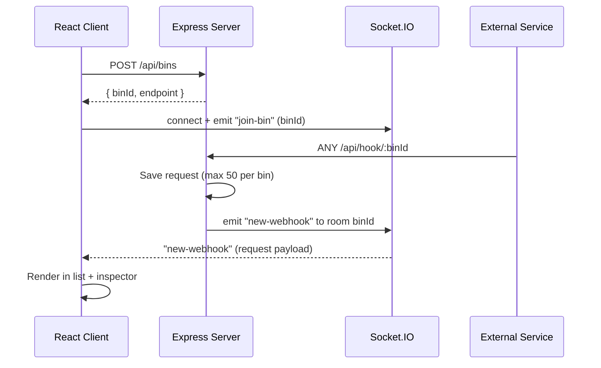

<div align="center">

# 🔭 HookLens

**A real-time webhook inspector. Get a unique URL, point any service at it, and watch requests appear instantly.**


</div>

---

## 📖 Table of Contents

- [Overview](#-overview)
- [Features](#-features)
- [Tech Stack](#-tech-stack)
- [Architecture](#-architecture)
- [Project Structure](#-project-structure)
- [Getting Started](#-getting-started)
- [Configuration](#-configuration)
- [Usage](#-usage)
- [API Reference](#-api-reference)
- [WebSocket Events](#-websocket-events)
- [Data Model](#-data-model)
- [Scripts](#-scripts)
- [Deployment Notes](#-deployment-notes)
- [Limitations & Roadmap](#-limitations--roadmap)
- [Contributing](#-contributing)
- [License](#-license)

---

## 🧭 Overview

When you build an integration with Stripe, GitHub, Shopify, Twilio, or any other service that sends webhooks, you often need to see exactly what they send: the headers, the query string, the JSON payload. **HookLens** gives you a disposable endpoint for that purpose.

Open the app and a unique endpoint is generated automatically. Send any HTTP request to it (`GET`, `POST`, `PUT`, `PATCH`, `DELETE`) and it shows up in the dashboard in real time, with its body, headers, query parameters, sender IP, and timestamp, with no page refresh required.

---

## ✨ Features

- **Instant endpoints**: a unique, UUID-based webhook URL is created on first load.
- **Any HTTP method**: a single route catches `GET`, `POST`, `PUT`, `PATCH`, `DELETE`, and more.
- **Live updates**: new requests are pushed to the browser over WebSockets (Socket.IO). No polling.
- **Request inspector**: tabbed view for **Body**, **Headers**, and **Query** with pretty-printed JSON.
- **One-click copy**: copy the endpoint URL or any tab's JSON to your clipboard.
- **Session persistence**: your bin ID is saved in `localStorage`, so reloading the page restores your endpoint and its request history.
- **Color-coded method badges** in the request list for quick scanning.
- **Bounded memory**: each bin keeps only its latest 50 requests.
- **Dark, responsive UI** built with Tailwind CSS, usable on desktop and mobile.
- **Health check** endpoint for uptime monitors and deployment platforms.

---

## 🛠 Tech Stack

| Layer      | Technology                                                                 |
| ---------- | -------------------------------------------------------------------------- |
| Frontend   | React 19, TypeScript, Vite, Tailwind CSS 4, Lucide icons, `socket.io-client` |
| Backend    | Node.js, Express 5, TypeScript, Socket.IO, `cors`, `dotenv`, `uuid`        |
| Storage    | In-memory (`Map`), no database required                                    |
| Tooling    | ESLint, `tsx` (dev server), `tsc` (build)                                  |

---

## 🏗 Architecture



**How it works**

1. On load, the client checks `localStorage` for a saved bin ID. If the bin still exists on the server, its history is restored; otherwise a new bin is created.
2. The client opens a Socket.IO connection and joins a **room** named after the bin ID.
3. Anything that hits `/api/hook/:binId` is stored in memory and broadcast to that room only, so other bins never see it.
4. The UI prepends the new request to the list and auto-selects it.

---

## 📁 Project Structure

```
hook-lens/
├── client/                      # React + Vite frontend
│   ├── public/
│   ├── src/
│   │   ├── components/
│   │   │   ├── Header.tsx           # Brand, endpoint URL bar, copy + "New Endpoint"
│   │   │   ├── RequestList.tsx      # Sidebar list of incoming requests
│   │   │   └── RequestInspector.tsx # Body / Headers / Query tabs
│   │   ├── types/index.ts           # Shared client-side types
│   │   ├── App.tsx                  # State, bin lifecycle, WebSocket wiring
│   │   ├── main.tsx
│   │   └── index.css
│   ├── index.html
│   ├── vite.config.ts
│   └── package.json
│
└── server/                      # Express + Socket.IO backend
    ├── src/
    │   ├── controllers/bin.controller.ts   # create bin, catch webhook, list requests
    │   ├── routes/bin.routes.ts            # route definitions
    │   ├── services/storage.service.ts     # in-memory store
    │   ├── sockets/socket.handler.ts       # rooms + broadcast
    │   ├── types/index.ts                  # WebhookRequest, Bin
    │   ├── app.ts                          # Express app, middleware, /health
    │   └── server.ts                       # HTTP server + Socket.IO bootstrap
    ├── .env.example
    ├── tsconfig.json
    └── package.json
```

---

## 🚀 Getting Started

### Prerequisites

- **Node.js** 20 or newer (the dependency versions used here require a recent LTS)
- **npm** (bundled with Node.js)

### 1. Clone the repository

```bash
git clone https://github.com/Puviraj-2004/hook-lens.git
cd hook-lens
```

### 2. Start the backend

```bash
cd server
npm install
cp .env.example .env      # on Windows: copy .env.example .env
npm run dev
```

The server starts on **http://localhost:5000** by default.

### 3. Start the frontend

Open a second terminal:

```bash
cd client
npm install
npm run dev
```

The app is served at **http://localhost:5173**.

### 4. Send your first webhook

Copy the endpoint from the header bar, then:

```bash
curl -X POST "http://localhost:5000/api/hook/<your-bin-id>?source=test" \
  -H "Content-Type: application/json" \
  -d '{"event": "user.created", "data": {"id": 42, "name": "Ada"}}'
```

It should appear in the dashboard immediately.

---

## ⚙️ Configuration

### Server (`server/.env`)

| Variable     | Default                  | Description                                                         |
| ------------ | ------------------------ | ------------------------------------------------------------------- |
| `PORT`       | `5000`                   | Port the HTTP and WebSocket server listens on.                      |
| `CLIENT_URL` | `http://localhost:5173`  | Allowed origin for Socket.IO CORS. Set this to your deployed frontend URL. |

### Client (`client/.env`, optional)

| Variable           | Default                  | Description                                       |
| ------------------ | ------------------------ | ------------------------------------------------- |
| `VITE_BACKEND_URL` | `http://localhost:5000`  | Base URL of the HookLens server (REST + WebSocket). |

Example `client/.env`:

```env
VITE_BACKEND_URL=https://your-hooklens-api.example.com
```

> The webhook URL shown in the UI is built from `VITE_BACKEND_URL`, so it must be a publicly reachable address if external services need to call it.

---

## 💡 Usage

1. **Open the app.** An endpoint like `http://localhost:5000/api/hook/3f2b...` is generated and shown in the header.
2. **Copy the URL** with the copy button and paste it into the webhook settings of the service you're testing.
3. **Trigger an event.** Requests stream into the left sidebar, newest first, and the latest is selected automatically.
4. **Inspect** the request using the **Body**, **Headers**, and **Query** tabs. Use **Copy JSON** to grab the active tab's contents.
5. **Need a fresh URL?** Click **New Endpoint**. This creates a new bin and clears the current view.

### Testing with other tools

```bash
# GET with query params
curl "http://localhost:5000/api/hook/<bin-id>?foo=bar&baz=1"

# Form-encoded body
curl -X POST "http://localhost:5000/api/hook/<bin-id>" -d "name=Ada&role=admin"

# PUT / DELETE
curl -X PUT    "http://localhost:5000/api/hook/<bin-id>" -H "Content-Type: application/json" -d '{"a":1}'
curl -X DELETE "http://localhost:5000/api/hook/<bin-id>"
```

To receive webhooks from the public internet while developing locally, expose your server with a tunnel such as [ngrok](https://ngrok.com/) or [Cloudflare Tunnel](https://developers.cloudflare.com/cloudflare-one/connections/connect-networks/), then set `VITE_BACKEND_URL` to the tunnel URL.

---

## 📡 API Reference

Base path: `/api`

### `POST /api/bins`

Creates a new bin.

**Response `201`**

```json
{
  "success": true,
  "binId": "3f2b8c1e-5a7d-4e2f-9b0a-1c2d3e4f5a6b",
  "endpoint": "/api/hook/3f2b8c1e-5a7d-4e2f-9b0a-1c2d3e4f5a6b"
}
```

### `GET /api/bins/:binId/requests`

Returns stored requests for a bin, newest first.

**Response `200`**

```json
{
  "success": true,
  "count": 1,
  "data": [
    {
      "id": "b7e1...",
      "binId": "3f2b...",
      "method": "POST",
      "headers": { "content-type": "application/json" },
      "query": { "source": "test" },
      "body": { "event": "user.created" },
      "ip": "::1",
      "timestamp": "2026-10-12T09:15:30.123Z"
    }
  ]
}
```

**Errors:** `400` invalid bin ID · `404` bin not found

### `ALL /api/hook/:binId`

The webhook receiver. Accepts **any HTTP method**. Stores the request and broadcasts it to connected clients.

**Response `200`**

```json
{ "success": true, "message": "Webhook received successfully" }
```

**Errors:** `400` invalid bin ID · `404` bin not found

### `GET /health`

```json
{ "status": "ok", "service": "HookLens Engine" }
```

---

## 🔌 WebSocket Events

| Event         | Direction        | Payload          | Description                                           |
| ------------- | ---------------- | ---------------- | ----------------------------------------------------- |
| `join-bin`    | Client → Server  | `binId: string`  | Joins the Socket.IO room for that bin.                |
| `new-webhook` | Server → Client  | `WebhookRequest` | Emitted to the bin's room whenever a webhook arrives. |

---

## 🗂 Data Model

```ts
interface WebhookRequest {
  id: string;                       // unique request ID (UUID)
  binId: string;                    // bin this request belongs to
  method: string;                   // GET, POST, PUT, ...
  headers: Record<string, any>;     // all request headers
  query: Record<string, any>;       // parsed query string
  body: any;                        // parsed JSON or form body (if any)
  ip: string;                       // sender IP address
  timestamp: string;                // ISO 8601
}
```

---

## 📜 Scripts

### Server (`/server`)

| Command         | Description                                     |
| --------------- | ----------------------------------------------- |
| `npm run dev`   | Start with hot reload via `tsx watch`.          |
| `npm run build` | Compile TypeScript to `dist/`.                  |
| `npm start`     | Run the compiled server (`node dist/server.js`). |

### Client (`/client`)

| Command           | Description                          |
| ----------------- | ------------------------------------ |
| `npm run dev`     | Start the Vite dev server.           |
| `npm run build`   | Type-check and build for production. |
| `npm run preview` | Preview the production build locally. |
| `npm run lint`    | Run ESLint.                          |

---

## ☁️ Deployment Notes

- **Backend:** build with `npm run build`, run with `npm start`, and set `PORT` and `CLIENT_URL`. Use a host that supports long-lived WebSocket connections (Render, Railway, Fly.io, a VPS, etc.).
- **Frontend:** run `npm run build` in `client/` and deploy the `dist/` folder to any static host (Vercel, Netlify, Cloudflare Pages). Set `VITE_BACKEND_URL` at build time to your backend's public URL.
- **CORS:** `CLIENT_URL` must exactly match your frontend's origin (including protocol, with no trailing slash) or the WebSocket connection will be rejected.
- **Single instance:** because storage is in-memory and Socket.IO rooms are local to the process, run one server instance (or add a shared store and the Socket.IO Redis adapter before scaling out).

---

## ⚠️ Limitations & Roadmap

**Current limitations**

- **Data is not persistent.** Bins and requests live in server memory and are lost when the server restarts.
- **No expiry or cleanup.** Bins are never removed automatically while the server runs.
- **50 requests per bin.** Older requests are dropped once the cap is reached.
- **No authentication.** Anyone who knows a bin ID can read its requests. Don't send secrets or sensitive production data to a public instance.
- **Body parsing** covers JSON and URL-encoded payloads. Other content types (plain text, XML, multipart, raw binary) will show an empty body.
- **Fixed response.** The endpoint always replies `200` with a JSON acknowledgment.

**Ideas for future improvements**

- [ ] Persistent storage (Redis / PostgreSQL / SQLite) with TTL-based bin expiry
- [ ] Support for raw, text, XML, and multipart bodies
- [ ] Custom response status, headers, and body per endpoint
- [ ] Request search, filtering by method, and delete / clear actions
- [ ] Replay or forward a captured request to another URL
- [ ] Signature verification helpers (Stripe, GitHub, etc.)
- [ ] Rate limiting and optional bin protection
- [ ] Docker and `docker-compose` setup
- [ ] Automated tests and CI

---

## 🤝 Contributing

Contributions are welcome!

1. Fork the repository
2. Create a feature branch: `git checkout -b feature/my-feature`
3. Commit your changes: `git commit -m "Add my feature"`
4. Push the branch: `git push origin feature/my-feature`
5. Open a Pull Request

Please run `npm run lint` in `client/` before submitting frontend changes.

---

## 📄 License

No license file is currently included in this repository. If you plan to share or accept contributions, consider adding one (for example, [MIT](https://choosealicense.com/licenses/mit/)) and updating this section.

---

<div align="center">

Built by [Puviraj](https://github.com/Puviraj-2004)

</div>